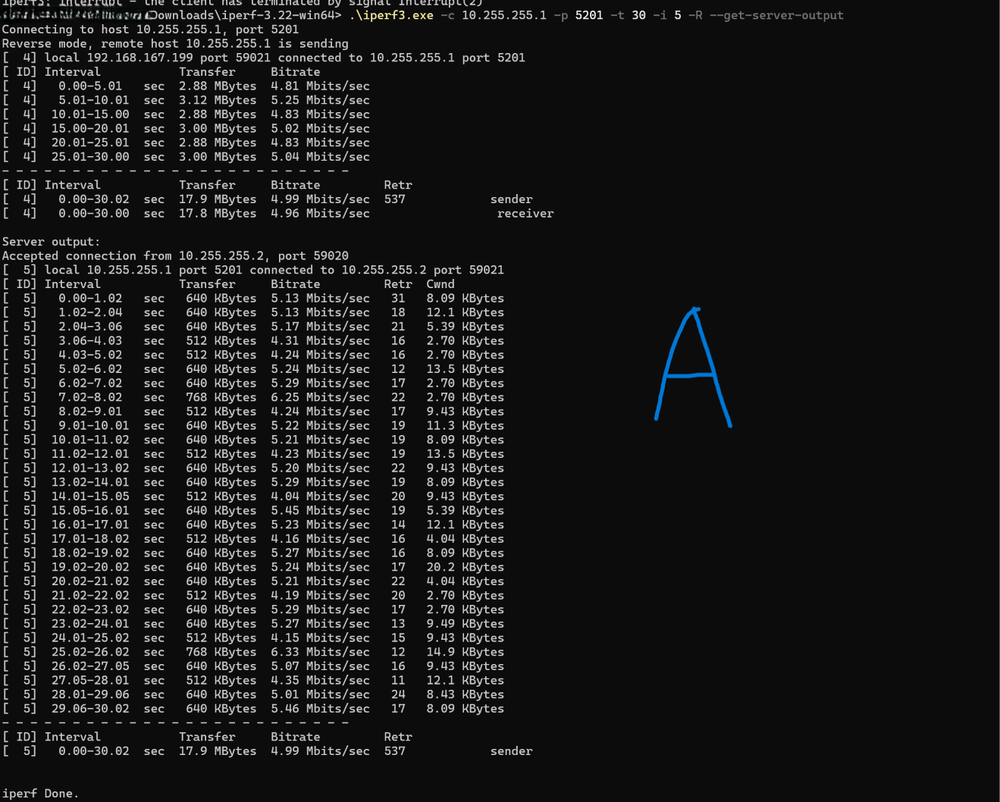
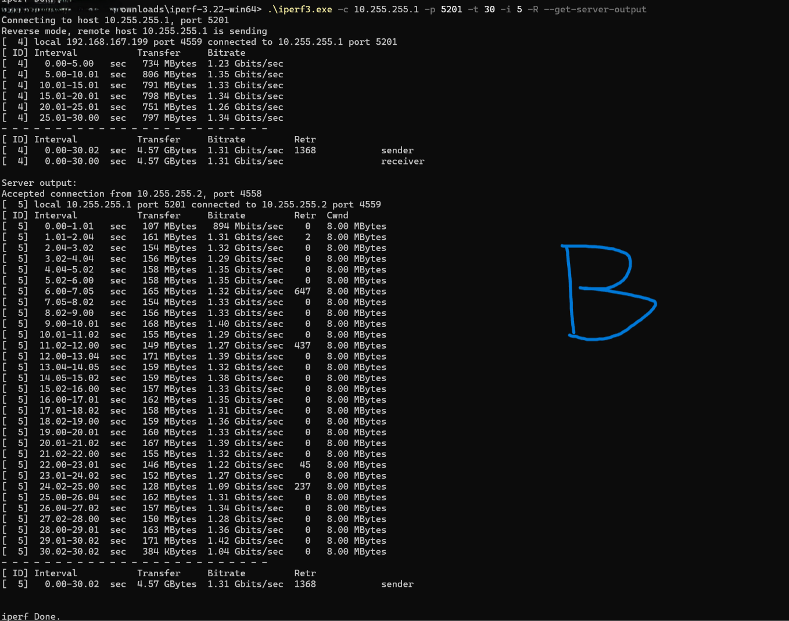
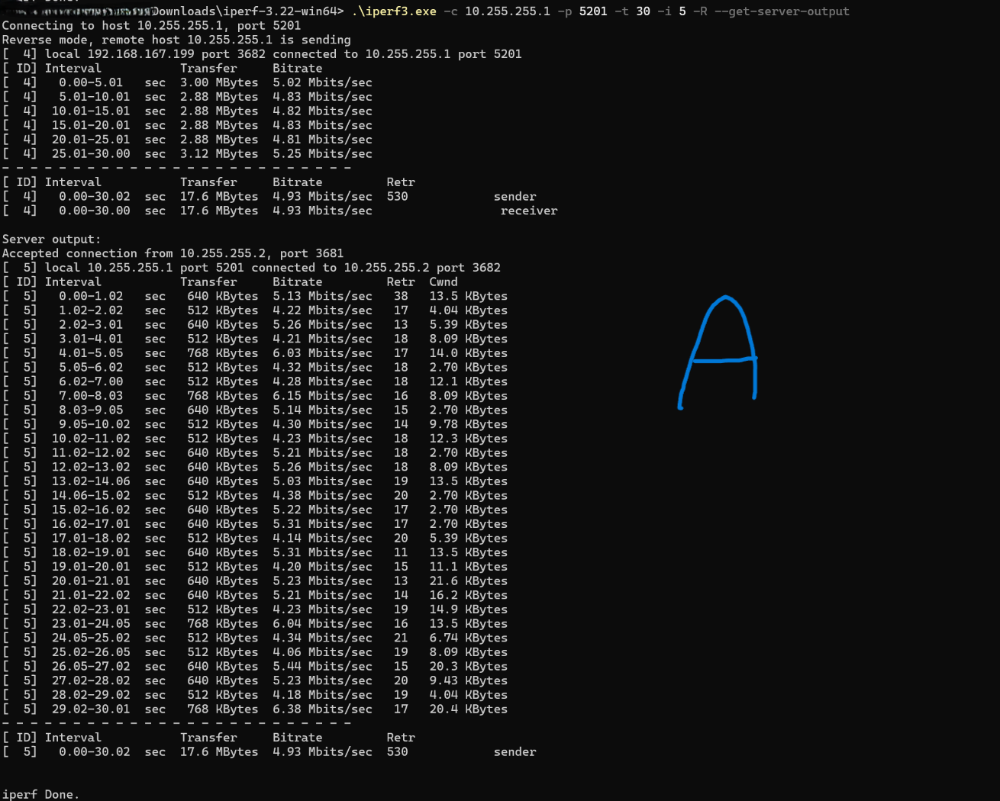

# WireGuard à ~5 Mbit/s sur CCR2004 : interaction entre réordonnancement des paquets et pile TCP FreeBSD

**Français** | [English](README.md)

Configuration : MikroTik **CCR2004-1G-12S+2XS, RouterOS 7.23.8**, connecté à une Freebox Ultra, tunnel WireGuard vers **OPNsense 26.7 chez OVH**. Un test TCP descendant, émis par OPNsense, plafonnait autour de **5 Mbit/s**.

L’analyse croisée des captures internes/externes du VPN et des échanges TCP a révélé deux phénomènes :

## 1. Un réordonnancement réel des paquets

Les compteurs des paquets WireGuard étaient ordonnés à la sortie d’OVH, mais environ **19 % arrivaient derrière un compteur déjà observé dans la capture WAN du CCR**, avec une profondeur maximale de neuf positions. Les SACK du PC confirmaient un désordre réel à la réception TCP, au-delà d’un simple artefact de capture. Aucun paquet TCP émis n’était manquant dans la comparaison de cette fenêtre.

Un indice fort : le même flux UDP WireGuard était réparti presque exactement entre **deux cœurs du CCR**, chaque sous-séquence restant ordonnée. Cela désigne le traitement parallèle en réception comme piste majeure, sans identifier définitivement l’étage responsable.

Les métadonnées CPU du sniffer MikroTik donnaient précisément, sur les **9 256 datagrammes UDP descendants** :

| Cœur indiqué dans la capture | Datagrammes capturés |
| --- | ---: |
| **CPU 1** | **4 627** |
| **CPU 3** | **4 629** |

En examinant séparément les paquets de données WireGuard de chaque cœur : **zéro inversion des compteurs sur CPU 1, zéro sur CPU 3**. Dans la séquence globale, **1 776 paquets sur 9 255** avaient un compteur inférieur au maximum déjà observé.

Cette signature est compatible avec deux chemins de traitement parallèles qui préservent chacun leur ordre, mais dont la recombinaison produit du désordre. Elle ne permet pas, seule, de départager matériel, pilote, distribution RX ou ordonnancement logiciel.

## 2. Une réaction pénalisante de la pile TCP classique de FreeBSD

Le désordre s’accompagnait de nombreuses retransmissions inutiles, confirmées par les DSACK, et d’une fenêtre de congestion souvent réduite à quelques kilo-octets. Le débit s’effondrait malgré l’absence de pertes mesurées sur cette capture.

Les **SACK** indiquent les blocs reçus au-delà d’un trou dans la séquence ; les **DSACK** signalent des données reçues en double. Une capture de 20 secondes montrait **366 retransmissions TCP et 358 ACK contenant un DSACK**, ce qui étaye fortement la présence de retransmissions superflues.

L’algorithme de congestion configuré était **CUBIC**, vérifié par `net.inet.tcp.cc.algorithm=cubic`. CUBIC fait évoluer la fenêtre de congestion suivant notamment une fonction cubique du temps écoulé depuis un événement de congestion. Si le réordonnancement est interprété comme une perte, les réactions de récupération et de réduction de fenêtre peuvent se répéter et empêcher le débit de progresser.

**CUBIC et RACK interviennent à des niveaux différents** : CUBIC gouverne la fenêtre de congestion ; la pile TCP alternative `rack` de FreeBSD change notamment la détection des pertes, leur récupération et la gestion des émissions. Le test consistait donc à remplacer **`freebsd` par `rack`, tout en conservant CUBIC**.

## Résultats du test contrôlé A → B → A

La sélection de la pile TCP **RACK sur l’émetteur OVH**, en conservant CUBIC, a donné ce résultat contrôlé :

| Pile TCP de l’émetteur | Débit reçu | Retransmissions sur 30 s |
| --- | ---: | ---: |
| `freebsd` — référence | 4,96 Mbit/s | 537 |
| `rack` | **1,31 Gbit/s** | 1 368 |
| Retour à `freebsd` | 4,93 Mbit/s | 530 |

| A1 · Référence `freebsd` | B · Passage à `rack` | A2 · Retour à `freebsd` |
| :---: | :---: | :---: |
|  |  |  |
| 4,96 Mbit/s | **1,31 Gbit/s** | 4,93 Mbit/s |

*Figure 1 — Débit TCP reçu pour chaque pile testée sur l’émetteur OPNsense, avec CUBIC dans les trois essais.*

La **Cwnd rapportée par iperf3** passait de quelques kilo-octets — souvent **2,70 KiB** — à **8,00 MiB** avec RACK. Le nombre absolu de retransmissions sous RACK doit être rapporté au volume transféré : **4,57 GiB contre environ 18 MiB**, soit plus de 260 fois davantage de données.

Le serveur iperf3 était redémarré entre les changements de pile pour renouveler sa socket d’écoute et les connexions de test.

**Le test A → B → A démontre une dépendance causale à la pile TCP émettrice**, avec un gain d’environ ×264. RACK change notamment la détection/récupération des pertes et la gestion de l’émission ; cette expérience n’isole pas leur contribution respective.

## Portée du correctif et limites

Le correctif validé concerne les connexions TCP terminées sur l’OPNsense OVH. Il ne modifie pas le TCP des machines dont celui-ci route simplement les paquets. **L’origine exacte du réordonnancement reste à confirmer : le résultat ne suffit pas à déclarer un bug précis de RouterOS, ni à considérer le désordre lui-même corrigé.**

## Références techniques

- [CUBIC — RFC 9438](https://www.rfc-editor.org/rfc/rfc9438.html)
- [RACK et piles TCP alternatives de FreeBSD](https://freebsdfoundation.org/our-work/journal/browser-based-edition/networking-10th-anniversary/rack-and-alternate-tcp-stacks-for-freebsd/)
