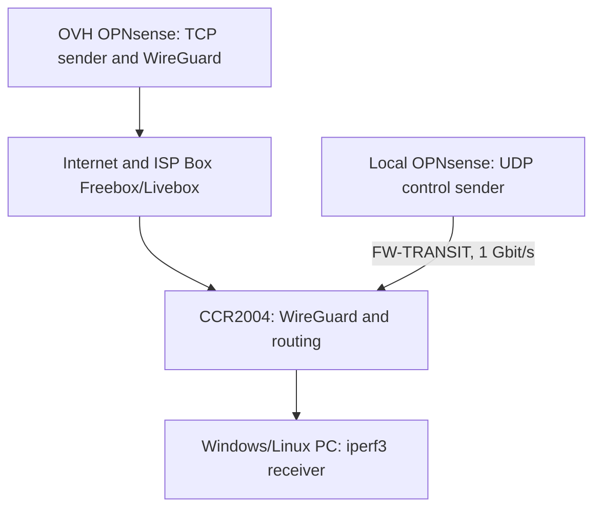
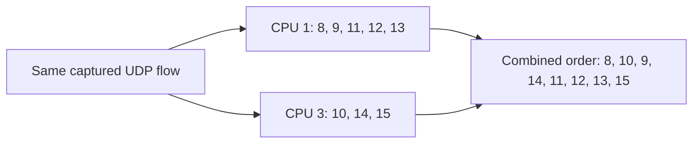
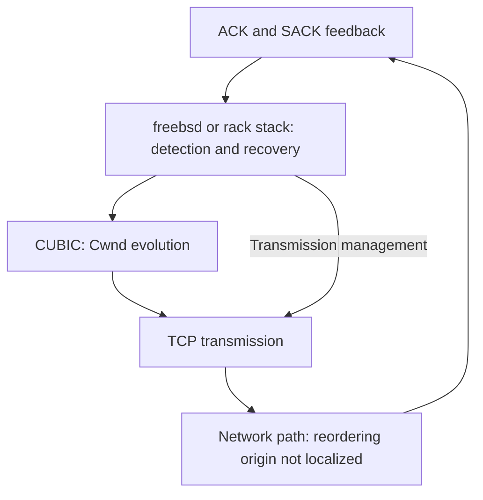

# Investigation follow-up — WireGuard on CCR2004, sniffer effects and RACK remediation

[Français](wireguard-ccr2004-freebsd-addendum.fr.md) | **English**  
**Date: 31 October 2026** · Supplement to the [initial report](README.md)

## What the additional tests establish

The downstream TCP ceiling persists **without a capture on the CCR: 5.24 Mbit/s received and 572 retransmissions over 30 seconds**, using the `freebsd` stack and CUBIC on the OVH OPNsense sender. The sniffer is therefore not required for the throughput collapse to occur.

However, a local UDP A → B → A control shows that enabling it **increases actual out-of-order delivery to the PC**: 5 out-of-order packets, then 143 with the sniffer running, then 2 after stopping it. The rate is approximately **41 times** the pooled rate of the two controls.

**Clarification to the initial report: the approximately 19% WireGuard reordering figure was measured with instrumentation enabled, not with the sniffer stopped.** SACK/DSACK evidence confirms a real phenomenon in the captured experiment; it does not make the capture non-intrusive.

The validated throughput remediation remains **RACK on the FreeBSD/OPNsense TCP sender, while retaining CUBIC**. The exact hardware or software origin of the reordering has not been 100% established. The VPN remains terminated on the CCR.

## 1. Scope and tested paths

| Component | Observed configuration |
| --- | --- |
| Router | MikroTik CCR2004-1G-12S+2XS, revision r3 |
| RouterOS / current RouterBOOT | 7.23.8 / 7.23.8 |
| CPU / memory | ARM64, 4 cores at 2 GHz / 4 GiB |
| Remote TCP sender | OPNsense 26.7 hosted at OVH, tunnel address `10.255.255.1` |
| Local WireGuard endpoint | CCR, interface `wg-ovh`, address `10.255.255.2` |
| iperf3 receiver | Windows/Linux PC, `192.168.167.199`, iperf3 3.22 |
| Local control | Local OPNsense at `10.10.99.2`, 1 Gbit/s `FW-TRANSIT` link |
| Freebox–CCR link during recent controls | Copper SFP+ module, negotiated at 2.5 Gbit/s; earlier tests also used fiber |



The local control traverses the CCR without passing through OVH, the Internet, the Freebox or WireGuard. It does not reproduce the WAN port, its link speed or tunnel processing, so its result cannot be directly extrapolated to VPN traffic.

## 2. Local UDP controls

### 2.1 Baseline without the sniffer

A single UDP flow is sent from the local OPNsense host to the PC: 1,200-byte payloads, a 10 Mbit/s target, and reverse mode `-R`.

| 20-second test | Datagrams | Out of order at PC | Rate | Reported losses |
| --- | ---: | ---: | ---: | ---: |
| Normal transmission, `-b 10M` | 20,839 | 0 | 0% | 0 |
| Bursts, `-b 10M/20` | 20,860 | 5 | 0.024% | 0 |

The `10M/20` notation requests bursts of 20 datagrams while targeting an average of 10 Mbit/s [1]. **10 Mbit/s is an imposed rate here, not a measurement of maximum capacity.**

### 2.2 CCR capture and receiver counter

In a captured 10-second burst test, UDP identifiers 1 through 10,440 are present exactly once at each CCR observation point. Payloads match exactly between ingress and egress.

| Observation point | Datagrams | Out of order | Rate |
| --- | ---: | ---: | ---: |
| CCR, `FW-TRANSIT rx` | 10,440 | 113 | 1.08% |
| CCR, `PC-HOME-10G tx` | 10,440 | 131 | 1.25% |
| iperf3, reception on the PC | 10,440 | 129 | 1.24% |

For the PCAP analysis, a datagram counts as out of order when its identifier is lower than the largest previously observed identifier. The capture and application counts are close, but the JSON does not include received identifiers: a packet-by-packet correspondence has not been demonstrated.

Capture metadata assigns **5,142 datagrams to CPU 1 and 5,298 to CPU 3**, at both ingress and egress. Each datagram retains the same reported core between those two observations. Identifiers remain strictly increasing within each core's subsequence.

This distribution concerns one UDP flow with constant addresses and ports. **These figures are volumes observed in a capture, not a packets-per-core limit or a measurement of CPU saturation.**

### 2.3 A → B → A: isolating the sniffer effect

The next three tests retain the same addresses, source port `55201`, server port `5201`, 1,200-byte payloads, bursts of 20 and a 10-second duration. The manipulated variable is whether the CCR sniffer is running, with its filters retained; Torch is closed.

| Test | CCR sniffer | Datagrams | Out of order at PC | Rate |
| --- | --- | ---: | ---: | ---: |
| A1 | Stopped | 10,440 | 5 | 0.0479% |
| B | Running | 10,420 | 143 | 1.3724% |
| A2 | Stopped | 10,440 | 2 | 0.0192% |

No losses are reported. The pooled control rate is `7 / 20,880 = 0.03352%`. The rate ratio is `(143 / 10,420) / (7 / 20,880) = 40.94`.

**The effect is reversible and measured at the receiving application.** This strongly supports an actual traffic disturbance caused by enabling the sniffer in this configuration. The approximately 41-fold increase describes this sample; it is not a general RouterOS constant or a confidence interval. Events may be correlated within bursts.

This protocol does not isolate the internal mechanism: copying overhead, synchronization between cores, queue processing or a change in software processing path remain possibilities.

## 3. Back to the VPN: the ceiling persists without capture

The remote TCP test is then repeated with the CCR sniffer stopped, Torch closed and OPNsense captures stopped. The sender is temporarily switched back to `freebsd`; the iperf3 server is recreated after the change. CUBIC remains selected.

| Measurement over 30 seconds | Result |
| --- | ---: |
| Throughput received by the PC | **5.2425 Mbit/s** |
| Sender throughput reported by OVH | 5.3095 Mbit/s |
| Retransmissions reported by OVH | **572** |
| MSS reported in the result | 1,380 bytes |
| Cwnd samples from the server text output | **1.35–21.6 KiB** |

The server accepts the connection from `10.255.255.2`, consistent with the CCR's SNAT and tunnel path. Cwnd is equivalent to approximately 1–16 segments at the sampled times; these samples are not a continuous trace.

**The TCP symptom is reproduced without the sniffer.** This JSON does not measure VPN reordering without instrumentation, however, and cannot distinguish loss, reordering and other causes of retransmissions in this new run.

## 4. Interpreting the two-core signature

The initial WireGuard capture showed 4,627 downstream datagrams on CPU 1 and 4,629 on CPU 3. Each data subsequence remained ordered, while their interleaving contained inversions. The local UDP control exhibits the same signature, at a different intensity.



*Example taken from the initial WireGuard capture. This diagram represents observed metadata, not a proven internal architecture.*

Software RPS was disabled on the inspected interfaces. Exposed network IRQ entries were read-only with `cpu=auto`. This does not reveal the effective packet distribution policy in hardware or the driver. Without evidence, the two observed cores cannot be equated with the port extender's two internal links.

The RouterOS sniffer observes internal RX/TX points around the firewall [2]. **The first inversion visible at an RX capture point does not prove that packets were already out of order on the wire.**

An external capture would have helped localize the phenomenon. It was not performed because setting it up required rewiring that was incompatible with operational constraints. No conclusion in this supplement relies on that unperformed experiment.

## 5. CUBIC, RACK and the scope of the result

CUBIC controls congestion-window evolution, including through a cubic function of time [3]. RACK-TLP uses transmission times and ACK/SACK feedback to infer losses, with a time-based allowance for reordering [4].

FreeBSD's `rack` stack extends beyond the RACK-TLP algorithm: it also changes SACK handling, recovery and transmission, including burst mitigation [5]. **The remedy is therefore not “replace CUBIC with RACK”: the tests retain CUBIC and replace the `freebsd` stack with `rack`.**



*Simplified functional model. The respective contributions of recovery and burst management have not been isolated.*

The earlier A → B → A remains the experimental validation of the remediation:

| Sender stack, CUBIC retained | Received throughput | Retransmissions / 30 s |
| --- | ---: | ---: |
| `freebsd` | 4.96 Mbit/s | 537 |
| `rack` | **1.31 Gbit/s** | 1,368 |
| Back to `freebsd` | 4.93 Mbit/s | 530 |

Approximately 4.57 GiB were transferred with RACK, versus roughly 18 MiB in the controls. Absolute retransmission counts are therefore not comparable without accounting for transferred volume. The throughput improvement was approximately 264-fold, without moving the VPN endpoint.

The initial captures contained 366 retransmissions and 358 ACKs carrying DSACK. They support the presence of many spurious retransmissions. They do not show a sender ignoring ACKs it had already received: an ACK being generated earlier at the PC does not mean it had reached OVH before the retransmission was sent.

## 6. Exact remediation on OPNsense/BSD

**Target: the OPNsense 26.7 host that sends the TCP traffic.** The following procedure enables RACK and makes it persistent in the OPNsense configuration. It requires no changes to cabling, the tunnel or WireGuard UDP ports.

### 6.1 Check the initial state

In a root shell on **OVH OPNsense**, including through the provider's console:

```sh
sysctl net.inet.tcp.functions_default
sysctl net.inet.tcp.functions_available
sysctl net.inet.tcp.cc.algorithm
```

The baseline in this investigation was `functions_default: freebsd` and `cc.algorithm: cubic`. If `rack` is already the default stack, proceed to the persistence checks.

### 6.2 Load and select RACK immediately

If `rack` does not appear in `functions_available`, load the module:

```sh
kldload tcp_rack
sysctl net.inet.tcp.functions_available
```

Proceed once `rack` is listed. Loading succeeded on the investigated host. A missing or incompatible module error requires checking the relevant kernel and version; it must not be ignored.

Then select the stack:

```sh
sysctl net.inet.tcp.functions_default=rack
sysctl net.inet.tcp.functions_default
sysctl net.inet.tcp.cc.algorithm
```

Expected results: `functions_default: rack` and, in this configuration, `cc.algorithm: cubic`. The stack-selection command does not change the CUBIC selection.

**Recreate the tested service's listening sockets after the change.** For iperf3, stop the existing server with `Ctrl+C` in its console, then restart it:

```sh
iperf3 -s -B 10.255.255.1 -p 5201
```

Accepted connections normally inherit their listening socket's stack. The global change targets new sockets and does not automatically migrate all existing connections [5].

### 6.3 Make the setting persistent

In **System → Settings → Tunables** on OVH OPNsense, add or update the following two entries without creating duplicates:

| Tunable | Value | Purpose |
| --- | --- | --- |
| `tcp_rack_load` | `YES` | Load RACK at boot |
| `net.inet.tcp.functions_default` | `rack` | Select RACK as the default stack |

Enter the values **without quotation marks**, save each entry and apply the changes. Keep the entries enabled if the interface exposes an enabled/disabled state.

OPNsense Tunables manage loader parameters and sysctls [6]. The 26.7 branch writes these settings into the loader configuration and applies available sysctls during startup [7]. `tcp_rack_load` is a loader setting: it is not checked with `sysctl tcp_rack_load`.

The preceding shell commands provide immediate activation. Persistence must be checked **after the next scheduled reboot**, using:

```sh
sysctl net.inet.tcp.functions_available
sysctl net.inet.tcp.functions_default
sysctl net.inet.tcp.cc.algorithm
```

Expected: `rack` available, `rack` selected by default, and CUBIC retained. The throughput validation presented here must not be confused with documented post-reboot validation, which is not supplied in this supplement.

### 6.4 Validate throughput

On the **CCR**, stop the sniffer and close Torch:

```routeros
/tool sniffer stop
```

From the PC, with the OVH iperf3 server recreated under RACK:

```powershell
.\iperf3.exe -c 10.255.255.1 -p 5201 -t 30 -i 5 -R --get-server-output
```

To retain a machine-readable result:

```powershell
.\iperf3.exe -c 10.255.255.1 -p 5201 -t 30 -i 5 -R --get-server-output -J --logfile ovh-rack-validation.json
```

Use a fresh log filename for each run. Retain the same path, one connection, the same duration and no other configuration changes. **1.31 Gbit/s is the observed result, not a guarantee for another installation.**

### 6.5 Rollback

To return to this investigation's baseline:

```sh
sysctl net.inet.tcp.functions_default=freebsd
```

Then recreate the affected service's listening sockets. In Tunables, set `net.inet.tcp.functions_default` back to `freebsd` and remove `tcp_rack_load=YES` if it was added solely for this remediation. If a different configuration existed before the test, restore its original values.

There is no need to unload the module while the system is running; other connections may still be using it.

## 7. What this remediation covers

| Case | Expected effect of the setting on OVH OPNsense |
| --- | --- |
| iperf3 or another TCP service running on this OPNsense host | RACK used by the applicable new sockets; throughput improvement validated here for iperf3 |
| A proxy that actually terminates TCP on this host | May benefit from this stack; validate the service and its new connections |
| TCP from a VM, container or server whose packets are simply routed/NATed | Sender TCP stack remains unchanged; this setting does not apply to it |
| UDP, WireGuard transport or RX distribution inside the CCR | No direct fix demonstrated |

RACK is an **operational throughput remediation** in this case. It has not been shown to remove the source of reordering or to fix every flow traversing the VPN.


## References

[1]: https://software.es.net/iperf/invoking.html
[2]: https://help.mikrotik.com/docs/spaces/ROS/pages/8323088/Packet+Sniffer
[3]: https://www.rfc-editor.org/rfc/rfc9438.html
[4]: https://www.rfc-editor.org/rfc/rfc8985.html
[5]: https://freebsdfoundation.org/our-work/journal/browser-based-edition/networking-10th-anniversary/rack-and-alternate-tcp-stacks-for-freebsd/
[6]: https://docs.opnsense.org/manual/settingsmenu.html#tunables
[7]: https://github.com/opnsense/core/blob/stable/26.7/src/etc/inc/system.inc

- [1 — iperf3 options and measurements][1]
- [2 — RouterOS sniffer capture points][2]
- [3 — CUBIC, RFC 9438][3]
- [4 — RACK-TLP loss detection, RFC 8985][4]
- [5 — Alternate TCP stacks and RACK in FreeBSD][5]
- [6 — OPNsense Tunables][6]
- [7 — OPNsense 26.7 implementation: `system_sysctl_configure()` and `loader.conf` generation][7]
