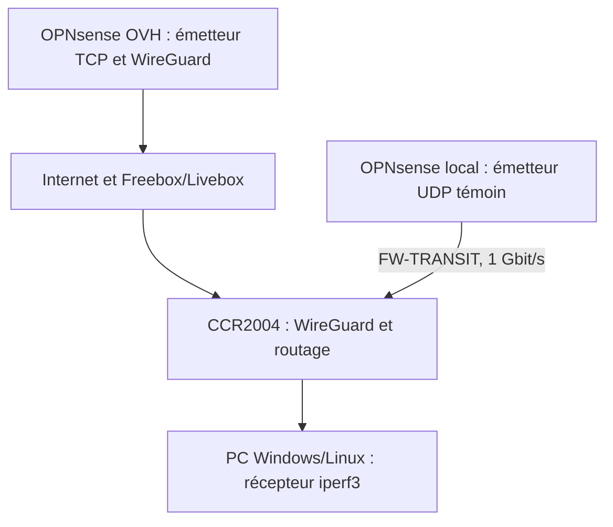
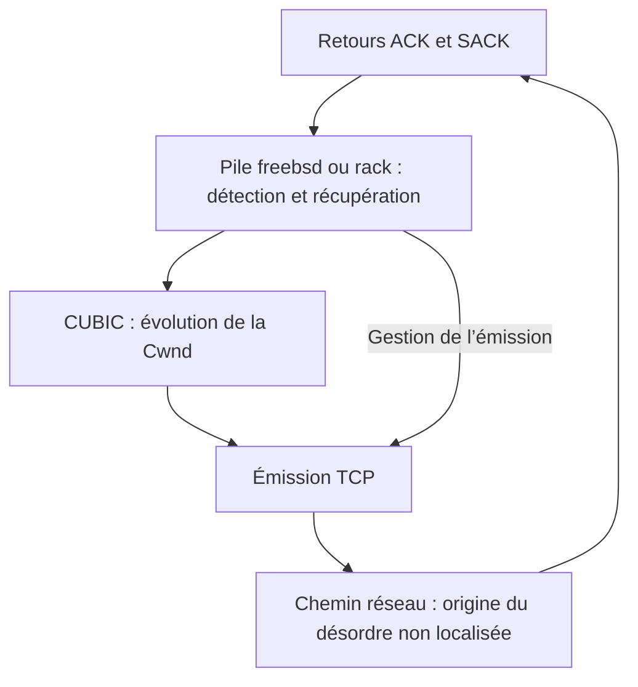

# Complément d’enquête — WireGuard sur CCR2004, effet du sniffer et remédiation RACK

**Français** | [English](wireguard-ccr2004-freebsd-addendum.en.md)  
**Date : 31 octobre 2026** · Complément à la [publication initiale](README.fr.md)

## Ce que les nouveaux essais établissent

Le plafond TCP descendant persiste **sans capture sur le CCR : 5,24 Mbit/s reçus et 572 retransmissions en 30 secondes**, avec la pile `freebsd` et CUBIC sur l’émetteur OPNsense OVH. Le sniffer n’est donc pas une condition nécessaire à l’effondrement.

En revanche, un contrôle UDP local A → B → A montre que son activation **augmente réellement le désordre reçu par le PC** : 5 paquets hors ordre, puis 143 avec le sniffer, puis 2 après son arrêt. Le taux est multiplié par environ **41** par rapport aux deux témoins regroupés.

**Précision à apporter à la publication initiale : les ~19 % de désordre WireGuard sont une mesure sous instrumentation, pas une mesure du fonctionnement sans sniffer.** Les SACK/DSACK confirment un phénomène réel dans l’expérience capturée ; ils ne rendent pas la capture neutre.

La remédiation de débit validée reste **RACK sur l’émetteur TCP FreeBSD/OPNsense, en conservant CUBIC**. L’origine matérielle ou logicielle exacte du réordonnancement n’est pas 100% établie. Le VPN reste terminé sur le CCR.

## 1. Périmètre et chemins testés

| Élément | Configuration observée |
| --- | --- |
| Routeur | MikroTik CCR2004-1G-12S+2XS, révision r3 |
| RouterOS / RouterBOOT courant | 7.23.8 / 7.23.8 |
| CPU / mémoire | ARM64, 4 cœurs à 2 GHz / 4 Gio |
| Émetteur TCP distant | OPNsense 26.7 chez OVH, adresse de tunnel `10.255.255.1` |
| Terminaison WireGuard locale | CCR, interface `wg-ovh`, adresse `10.255.255.2` |
| Récepteur iperf3 | PC Windows/Linux, `192.168.167.199`, iperf3 3.22 |
| Témoin local | OPNsense local `10.10.99.2`, liaison `FW-TRANSIT` à 1 Gbit/s |
| Liaison Freebox–CCR lors des contrôles récents | SFP+ cuivre, négociation à 2,5 Gbit/s ; essais antérieurs également en optique |



Le témoin local traverse le CCR sans passer par OVH Cloud, Internet, la Freebox ou WireGuard. Il ne reproduit toutefois ni le port WAN, ni sa vitesse, ni le traitement du tunnel : son résultat ne s’extrapole pas directement au trafic VPN.

## 2. Contrôles UDP locaux

### 2.1 Référence sans sniffer

Un flux UDP unique est émis de l’OPNsense local vers le PC : charge utile de 1 200 octets, cible de 10 Mbit/s, mode inverse `-R`.

| Essai de 20 secondes | Datagrammes | Hors ordre au PC | Proportion | Pertes déclarées |
| --- | ---: | ---: | ---: | ---: |
| Émission normale, `-b 10M` | 20 839 | 0 | 0 % | 0 |
| Rafales, `-b 10M/20` | 20 860 | 5 | 0,024 % | 0 |

La notation `10M/20` demande des rafales de 20 datagrammes tout en visant 10 Mbit/s en moyenne [1]. **10 Mbit/s est ici un débit imposé, pas une mesure de capacité maximale.**

### 2.2 Capture CCR et compteur du récepteur

Sur un essai en rafales de 10 secondes avec capture, les identifiants UDP 1 à 10 440 sont présents une fois à chaque point d’observation du CCR. Les charges utiles correspondent exactement entre entrée et sortie.

| Point d’observation | Datagrammes | Hors ordre | Proportion |
| --- | ---: | ---: | ---: |
| CCR, `FW-TRANSIT rx` | 10 440 | 113 | 1,08 % |
| CCR, `PC-HOME-10G tx` | 10 440 | 131 | 1,25 % |
| iperf3, réception sur le PC | 10 440 | 129 | 1,24 % |

Pour l’analyse PCAP, un datagramme est compté hors ordre si son identifiant est inférieur au maximum déjà observé. Les compteurs PCAP et applicatif sont proches, mais le JSON ne contient pas les identifiants reçus : leur correspondance paquet par paquet n’est pas démontrée.

Les métadonnées de capture attribuent **5 142 datagrammes au CPU 1 et 5 298 au CPU 3**, aussi bien en entrée qu’en sortie. Chaque datagramme conserve le même cœur entre ces deux observations. Dans chaque sous-séquence de cœur, les identifiants restent strictement croissants.

Cette répartition concerne un même flux UDP, avec adresses et ports constants. **Ces nombres sont des volumes observés sur une capture, pas une limite de paquets par cœur ni une mesure de saturation CPU.**

### 2.3 A → B → A : isoler l’effet du sniffer

Les trois essais suivants conservent les mêmes adresses, le port source `55201`, le port serveur `5201`, la taille de 1 200 octets, les rafales de 20 et une durée de 10 secondes. La variable manipulée est l’activation du sniffer CCR, avec ses filtres conservés ; Torch est fermé.

| Essai | Sniffer CCR | Datagrammes | Hors ordre au PC | Proportion |
| --- | --- | ---: | ---: | ---: |
| A1 | Arrêté | 10 440 | 5 | 0,0479 % |
| B | Actif | 10 420 | 143 | 1,3724 % |
| A2 | Arrêté | 10 440 | 2 | 0,0192 % |

Aucune perte n’est déclarée. Le taux témoin regroupé vaut `7 / 20 880 = 0,03352 %`. Le rapport de taux vaut `(143 / 10 420) / (7 / 20 880) = 40,94`.

**L’effet est réversible et mesuré dans l’application réceptrice.** Cela étaye fortement une perturbation du trafic par l’activation du sniffer dans cette configuration. Le facteur ×41 décrit cet échantillon ; ce n’est pas une constante générale de RouterOS, ni un intervalle de confiance. Les événements peuvent être corrélés au sein des rafales.

Ce protocole n’isole pas le mécanisme interne : coût de la copie, synchronisation entre cœurs, traitement des files ou modification du chemin logiciel restent des possibilités.

## 3. Retour au VPN : le plafond persiste sans capture

Le test TCP distant est ensuite répété avec le sniffer CCR arrêté, Torch fermé et les captures OPNsense arrêtées. La pile de l’émetteur est temporairement remise sur `freebsd` ; le serveur iperf3 est recréé après ce changement. CUBIC reste sélectionné.

| Mesure sur 30 secondes | Résultat |
| --- | ---: |
| Débit reçu par le PC | **5,2425 Mbit/s** |
| Débit émis rapporté par OVH Cloud| 5,3095 Mbit/s |
| Retransmissions rapportées par OVH Cloud | **572** |
| MSS annoncé dans le résultat | 1 380 octets |
| Cwnd, échantillons du texte serveur | **1,35 à 21,6 Kio** |

Le serveur accepte la connexion depuis `10.255.255.2`, conformément au SNAT et au tunnel du CCR. La Cwnd représente environ 1 à 16 segments aux instants échantillonnés ; ces échantillons ne constituent pas un suivi continu.

**Le symptôme TCP est reproduit sans le sniffer.** Ce JSON ne mesure toutefois pas le taux de réordonnancement du VPN sans instrumentation et ne permet pas de départager pertes, désordre et autres causes des retransmissions sur ce nouvel essai.

## 4. Ce que signifie la signature à deux cœurs

La première capture WireGuard montrait 4 627 datagrammes descendants sur le CPU 1 et 4 629 sur le CPU 3. Chaque sous-séquence de données restait ordonnée, alors que leur entrelacement présentait des inversions. Le témoin UDP local retrouve cette signature, avec une intensité différente.


*Exemple tiré de la capture WireGuard initiale. Ce schéma représente les métadonnées observées, pas une architecture interne démontrée.*

Le RPS logiciel était désactivé sur les interfaces inspectées. Les IRQ réseau exposées étaient en lecture seule avec `cpu=auto`. Cela ne révèle pas la politique effective de distribution des paquets dans le matériel ou le pilote. Les deux cœurs observés ne peuvent pas être assimilés, sans preuve, aux deux liaisons internes du port extender.

Le sniffer RouterOS observe des points internes RX/TX autour du pare-feu [2]. **La première inversion visible à un point RX n’est pas une preuve que les paquets étaient déjà désordonnés sur le câble.**

Une capture externe aurait permis de mieux localiser le phénomène. Elle n’a pas été réalisée, car son installation nécessitait un recâblage incompatible avec les contraintes d’exploitation. Aucune conclusion de ce complément ne repose sur cette expérience non effectuée.

## 5. CUBIC, RACK et portée du résultat

CUBIC contrôle l’évolution de la fenêtre de congestion, notamment au moyen d’une fonction cubique du temps [3]. RACK-TLP utilise les temps d’émission et les ACK/SACK pour inférer les pertes, avec une tolérance temporelle au réordonnancement [4].

La pile FreeBSD `rack` dépasse l’algorithme RACK-TLP : elle change aussi la gestion des SACK, la récupération et l’émission, notamment la limitation des rafales [5]. **Le correctif n’est donc pas « remplacer CUBIC par RACK » : les essais conservent CUBIC et remplacent la pile `freebsd` par `rack`.**



*Modèle fonctionnel simplifié. La contribution respective de la récupération et de la gestion des rafales n’a pas été isolée.*

Le précédent A → B → A reste la validation expérimentale de la remédiation :

| Pile émettrice, CUBIC conservé | Débit reçu | Retransmissions / 30 s |
| --- | ---: | ---: |
| `freebsd` | 4,96 Mbit/s | 537 |
| `rack` | **1,31 Gbit/s** | 1 368 |
| Retour à `freebsd` | 4,93 Mbit/s | 530 |

Le volume transféré sous RACK est d’environ 4,57 Gio, contre environ 18 Mio dans les témoins. Les nombres absolus de retransmissions ne sont donc pas comparables sans tenir compte du volume. Le gain de débit est d’environ ×264, sans déplacement du VPN.

Les captures initiales comportaient 366 retransmissions et 358 ACK avec DSACK. Elles étayent de nombreuses retransmissions superflues. Elles ne montrent pas un émetteur ignorant des ACK déjà reçus : l’antériorité d’un ACK à la réception sur le PC ne signifie pas que cet ACK était parvenu à OVH avant la retransmission.

## 6. Remédiation exacte sur OPNsense / BSD

**Cible : l’OPNsense 26.7 qui émet le TCP.** La procédure suivante active RACK et le rend persistant dans la configuration OPNsense. Elle ne nécessite aucune modification du câblage, du tunnel ou des ports UDP WireGuard.

### 6.1 Vérifier l’état initial

Dans un shell root sur **OPNsense OVH Cloud**, y compris via la console du fournisseur :

```sh
sysctl net.inet.tcp.functions_default
sysctl net.inet.tcp.functions_available
sysctl net.inet.tcp.cc.algorithm
```

L’état de référence de cette enquête était `functions_default: freebsd` et `cc.algorithm: cubic`. Si `rack` est déjà la pile par défaut, passer aux vérifications de persistance.

### 6.2 Charger et sélectionner RACK immédiatement

Si `rack` n’apparaît pas dans `functions_available`, charger le module :

```sh
kldload tcp_rack
sysctl net.inet.tcp.functions_available
```

Poursuivre lorsque `rack` est présent. Sur la machine étudiée, ce chargement a réussi. Une erreur de module absent ou incompatible exige de vérifier le noyau et la version concernés ; elle ne doit pas être ignorée.

Sélectionner ensuite la pile :

```sh
sysctl net.inet.tcp.functions_default=rack
sysctl net.inet.tcp.functions_default
sysctl net.inet.tcp.cc.algorithm
```

Résultats attendus : `functions_default: rack` et, dans cette configuration, `cc.algorithm: cubic`. La commande de sélection de pile ne change pas le choix de CUBIC.

**Recréer les sockets d’écoute du service testé après le changement.** Pour iperf3, arrêter le serveur existant avec `Ctrl+C` dans sa console, puis le relancer :

```sh
iperf3 -s -B 10.255.255.1 -p 5201
```

Les connexions acceptées héritent normalement de la pile de leur socket d’écoute. Le changement global vise les nouveaux sockets et ne migre pas automatiquement toutes les connexions existantes [5].

### 6.3 Rendre le réglage persistant

Dans **System → Settings → Tunables** de l’OPNsense OVH, ajouter ou modifier les deux entrées suivantes, sans doublon :

| Tunable | Valeur | Rôle |
| --- | --- | --- |
| `tcp_rack_load` | `YES` | Charger RACK au démarrage |
| `net.inet.tcp.functions_default` | `rack` | Sélectionner RACK par défaut |

Saisir les valeurs **sans guillemets**, enregistrer chaque entrée et appliquer les changements. Conserver les entrées actives si l’interface propose un état activé/désactivé.

Les Tunables OPNsense gèrent les paramètres du chargeur et les sysctls [6]. Le code de la branche 26.7 écrit ces paramètres dans la configuration du chargeur et applique les sysctls disponibles au démarrage [7]. `tcp_rack_load` est un réglage du chargeur : il ne se vérifie pas avec `sysctl tcp_rack_load`.

L’activation immédiate est assurée par les commandes précédentes. La persistance doit être contrôlée **après le prochain redémarrage planifié**, avec :

```sh
sysctl net.inet.tcp.functions_available
sysctl net.inet.tcp.functions_default
sysctl net.inet.tcp.cc.algorithm
```

Attendus : `rack` disponible, `rack` par défaut, CUBIC conservé. La validation de débit présentée ici ne doit pas être confondue avec une preuve documentée de validation après redémarrage, qui n’est pas fournie dans ce complément.

### 6.4 Vérifier le débit

Sur le **CCR**, arrêter le sniffer et fermer Torch :

```routeros
/tool sniffer stop
```

Depuis le PC, avec le serveur iperf3 OVH recréé sous RACK :

```powershell
.\iperf3.exe -c 10.255.255.1 -p 5201 -t 30 -i 5 -R --get-server-output
```

Pour conserver un résultat exploitable :

```powershell
.\iperf3.exe -c 10.255.255.1 -p 5201 -t 30 -i 5 -R --get-server-output -J --logfile ovh-rack-validation.json
```

Choisir un nom de journal neuf à chaque essai. Garder le même trajet, une seule connexion, la même durée et aucun autre changement de configuration. **1,31 Gbit/s est le résultat observé, pas une garantie pour une autre installation.**

### 6.5 Retour arrière

Pour revenir à l’état de référence de cette enquête :

```sh
sysctl net.inet.tcp.functions_default=freebsd
```

Recréer ensuite les sockets d’écoute du service concerné. Dans les Tunables, remettre `net.inet.tcp.functions_default` à `freebsd` et retirer l’entrée `tcp_rack_load=YES` si elle avait été ajoutée uniquement pour cette remédiation. Si une configuration différente existait avant l’essai, restaurer ses valeurs initiales.

Il n’est pas nécessaire de décharger le module à chaud ; d’autres connexions peuvent encore l’utiliser.

## 7. Ce que cette remédiation couvre

| Cas | Effet attendu du réglage sur OPNsense OVH |
| --- | --- |
| iperf3 ou autre service TCP exécuté sur cet OPNsense | Utilisation de RACK par les nouveaux sockets concernés ; gain validé ici pour iperf3 |
| Proxy qui termine effectivement TCP sur cet hôte | Peut bénéficier de cette pile, à valider pour le service et ses nouvelles connexions |
| TCP d’une VM, d’un conteneur ou d’un serveur simplement routé/NATé | Pile TCP de l’émetteur inchangée ; ce réglage ne s’y applique pas |
| UDP, transport WireGuard ou distribution RX dans le CCR | Aucun correctif direct démontré |

RACK constitue ici une **remédiation opérationnelle du débit**. Il n’a pas été démontré qu’il supprime la source du désordre, ni qu’il corrige tous les flux traversant le VPN.

## Références

[1]: https://software.es.net/iperf/invoking.html
[2]: https://help.mikrotik.com/docs/spaces/ROS/pages/8323088/Packet+Sniffer
[3]: https://www.rfc-editor.org/rfc/rfc9438.html
[4]: https://www.rfc-editor.org/rfc/rfc8985.html
[5]: https://freebsdfoundation.org/our-work/journal/browser-based-edition/networking-10th-anniversary/rack-and-alternate-tcp-stacks-for-freebsd/
[6]: https://docs.opnsense.org/manual/settingsmenu.html#tunables
[7]: https://github.com/opnsense/core/blob/stable/26.7/src/etc/inc/system.inc

- [1 — Options et mesures iperf3][1]
- [2 — Points de capture du sniffer RouterOS][2]
- [3 — CUBIC, RFC 9438][3]
- [4 — Détection de pertes RACK-TLP, RFC 8985][4]
- [5 — Piles TCP alternatives et RACK dans FreeBSD][5]
- [6 — Tunables OPNsense][6]
- [7 — Implémentation OPNsense 26.7 : `system_sysctl_configure()` et génération de `loader.conf`][7]
